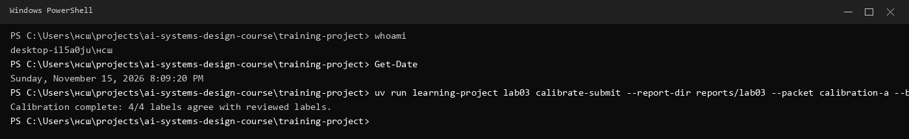
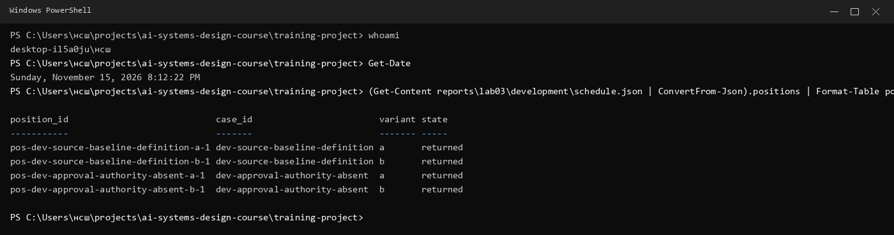
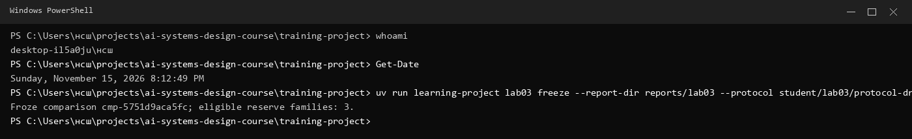
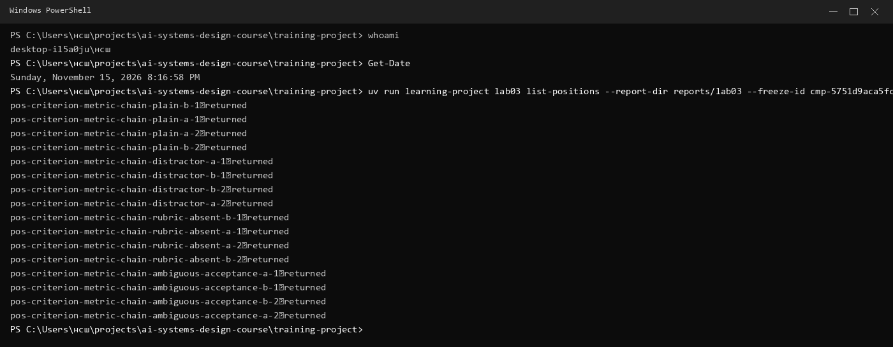
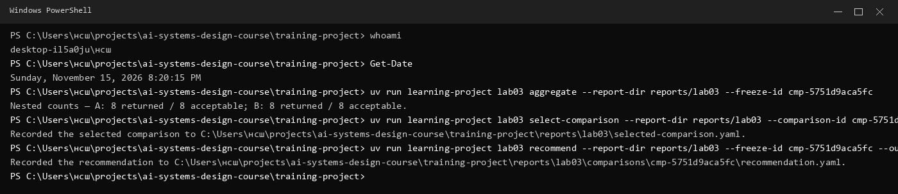
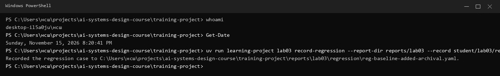

# Лабораторна робота 03

Заповнити кожен розділ українською мовою. Не вилучати заголовки. Відокремлювати спостережені результати від інженерних висновків і рішень. Для статусу `complete` залишити всі наведені відносні шляхи до знімків екрана. Для статусу `honest-partial` вилучити лише посилання на знімки контрольних точок, яких робота не досягла, але залишити посилання на кожний наявний знімок і на `07-final-verification.png`. Не створювати зображення-заповнювачі. На кожному наявному знімку мають бути видимі обліковий запис операційної системи або GitHub і системна дата.

## Ідентифікація подання

- URL форку: https://github.com/ashemet3/ai-systems-design-course
- Назва особистої гілки: lab03/shemet-anastasiia
- Статус завершення: complete

Повний хеш остаточного коміту та результат його перевірки містяться в окремому згенерованому `verification-report.json`. Їх не вписують у цей звіт до коміту, оскільки така зміна створила б інший коміт.

## Мета роботи

Отримати об'єктивні емпіричні та семантичні свідчення, необхідні інженерній команді для ухвалення рішення про те, чи повинна кандидатна конфігурація (варіант B) замінити базову конфігурацію (варіант A) для операції пропозиції понять за допомогою моделі на основі наданих джерел.

## Початковий стан і межа лабораторної роботи 02

Перед початком виконання лабораторної роботи 03 було проведено синхронізацію особистого форку з базовим репозиторієм курсу. На тимчасовій копії каталогу свідчень успішно пройдено вхідну перевірку допуску `learning-project lab02 verify`, що підтвердило цілісність та автентичність артефактів попередньої роботи. Лабораторна робота 03 суворо зберігає встановлені межі: прийняте поняття `Structured Output`, файли рішень і операцій у зовнішньому сховищі Obsidian Vault залишилися незмінними, а їхній аудиторський ланцюг не зазнав жодних модифікацій.

## Калібрування оцінювача

Для калібрування людського оцінювача застосовано активний авторський пакет `calibration-a`, що містить чотири еталонні фікстури. Застосовано абсолютну рубрику оцінювання (`S`, `I`, `U`, `Q`, `R`, `X`) відповідно до очікуваної поведінки кожного завдання. За результатами виконання `calibrate-submit` зафіксовано 100% узгодженість (4/4) призначених студентом міток із перевіреними еталонними мітками курсу: фікстура `cal-a-1` отримала `S` (повне підкріплення визначення базового стану), `cal-a-2` отримала `I` (підкріплена, але неповна відповідь без зазначення ролі в розгляді), `cal-a-3` отримала `U` (критична відмова через вигадане твердження про автоматичне затвердження), а `cal-a-4` отримала `Q` (обґрунтована невизначеність щодо строку зберігання). Авторські приклади калібрування готують оцінювача до однакового застосування правил рубрики і не є свідченням якості роботи моделі.

Рисунок — `01-calibration.png`

## Розробницькі випадки

У межах розробки використано два контрольовані курсом випадки:
1. `dev-source-baseline-definition` — містить достатні джерельні свідчення для формулювання точного поняття базового стану джерела як орієнтира для розгляду пропозицій.
2. `dev-approval-authority-absent` — надане джерело описує збереження рішення, але не називає суб'єкта із повноваженнями затверджувати зміни, тому очікуваною поведінкою є пряме повідомлення про відсутність цієї інформації в джерелі.

## Розробницькі запуски й діагноз варіанта A

На розробницьких випадках було заплановано та виконано чотири спроби: дві для варіанта A (`pos-dev-source-baseline-definition-a-1`, `pos-dev-approval-authority-absent-a-1`) та дві для варіанта B (`pos-dev-source-baseline-definition-b-1`, `pos-dev-approval-authority-absent-b-1`). Усі чотири спроби досягли кінцевого стану `returned` і успішно пройшли перевірку `dev-structural-check: valid`, повернувши валідний двопольовий JSON-об'єкт. Діагноз варіанта A показав, що за загальної інструкції модель схильна генерувати розлогі міркування, проте не має чіткого системного обмеження на констатацію неповноти джерела, що створює ризик непідкріплених тверджень при ускладненні завдань. Результати розробки використано лише для діагностики і не змішано з фінальним відкладеним порівнянням.

Рисунок — `02-development.png`

## Єдина зміна у варіанті B

У варіанті B змінено рівно одну властивість системної інструкції — додано правило підкріплення джерелом (`source grounding constraint`). Замість базової фрази «Answer the task about the supplied source» у варіанті B введено однозначне обмеження: спиратися виключно на факти, безпосередньо підтверджені наданим джерелом, та прямо констатувати відсутність інформації, якщо джерело не містить відповіді. Механізм впливу полягає в запобіганні галюцинаціям (`U`) та стимулюванні обґрунтованої невизначеності (`Q`). Усі інші параметри: контракт виходу (`case_id`, `proposed_text`), формулювання завдань, маршрут `openrouter/free` та температура залишені абсолютно незмінними для збереження чистоти експерименту.

## Заморожений протокол

Доступу до відкладених матеріалів передувало створення та фіксація протоколу `protocol-draft.yaml`. Протокол визначає інженерне рішення щодо доцільності заміни A на B, гіпотезу про усунення критичних відмов підкріплення, критерій семантичного прийняття (100% прийнятних за рубрикою відповідей без критичних помилок), блокувальну умову (неприпустимість появи категорії `U`), часову межу затримки (до 30 с) та фіксований бюджет у 16 спроб. Протокол зафіксовано командою `lab03 freeze` з ідентифікатором маніфесту `cmp-5751d9aca5fc`, що унеможливлює модифікацію правил або коду після розкриття контрольних кейсів.

Рисунок — `03-freeze.png`

## Вибір відкладеної родини та виконання

Після заморозки протоколу CLI призначив для експерименту родину контрольних кейсів `reserve-criteria-chain` (стан експозиції зафіксовано в `exposure-ledger.json`). Було згенеровано збалансований розклад із 16 позицій: 4 відкладені кейси × 2 конфігурації × 2 повтори. Усі 16 запланованих запусків було виконано у суворо визначеному порядку через маршрут `openrouter/free`. Усі позиції завершилися результатом `returned`, жодна спроба не зазнала збою або тайм-ауту, і для кожної сформованої відповіді перевірка `structural-check` зафіксувала статус `valid`.

Рисунок — `04-held-out-execution.png`

## Сліпе семантичне оцінювання

Для усунення суб'єктивного упередження оцінювача команда `build-scoring` згенерувала знеособлене подання `scoring-view.json` із 16 анонімними ідентифікаторами (`blind-001` .. `blind-016`), у якому приховано належність відповідей до варіантів A або B. Як людина-оцінювач, студент зіставив кожну кандидатну відповідь із затвердженою очікуваною поведінкою та текстом джерела:
- Позиції `blind-001`–`blind-008` (завдання на зв'язок критерію і метрики, включно з варіантами з дистрактором про бекапи) отримали категорію `S` (усі твердження підкріплені джерелом, зв'язок порівняння збережено, дистрактор проігноровано).
- Позиції `blind-009`–`blind-016` (завдання з відсутньою кількістю категорій або неоднозначною умовою прийняття) отримали категорію `Q` (модель обґрунтовано вказала на відсутність даних або неоднозначність замість вигадування чисел чи значень).
Жодна відповідь не отримала критичної оцінки `U`, непотрібної відмови `R` чи непридатності `X`.

## Агрегати, зрізи й операційні свідчення

Команда `lab03 aggregate` об'єднала знеособлені оцінки зі схемою експерименту та розрахувала послідовні підрахунки воронки подій:
1. `attempted`: варіант A — 8, варіант B — 8;
2. `returned`: варіант A — 8, варіант B — 8;
3. `structurally_valid`: варіант A — 8, варіант B — 8;
4. `assessable`: варіант A — 8, варіант B — 8;
5. `rubric_acceptable`: варіант A — 8, варіант B — 8.

Допоміжні свідчення: критичних непідтриманих відповідей (`U`) — 0 в обох варіантах; незапущених позицій — 0; закритих спроб — 0. Відмінності між першою та другою спробами на однакових кейсах мали виключно стилістичний характер перефразування зі збереженням повної семантичної тотожності.

## Обмежене рішення щодо конфігурації

На основі зафіксованих умов протоколу та емпіричних результатів команда інженерів ухвалила рішення `recommend-b`. Обидві конфігурації показали 100% результат прийнятності за рубрикою (8/8) та нульову кількість блокувальних відмов. Відповідно до зафіксованого правила компромісу (`tradeoff_rule`), кандидатна конфігурація B рекомендується до впровадження, оскільки вона явно містить системне обмеження підкріплення джерелом, яке гарантує стійкість системи проти непідкріплених тверджень в умовах розширення бази знань. Прийняте рішення є суто інженерною рекомендацією щодо конфігурації промпту і не надає повноважень на розгортання або автоматичний запис знань до сховища.

Рисунок — `05-scoring-recommendation.png`

## Регресійний запис

Оскільки під час живого експерименту жоден варіант не припустився семантичного збою, згідно з інструкцією до кроку 9 для формування регресійного випадку використано офіційну авторську фікстуру курсу `authored-failure-supported-plus-invented` (кейс `reg-baseline-added-archival`). Діагноз зафіксував порушення семантичної межі: додавання вигаданого твердження про «автоматичне архівування відхилених пропозицій», якого немає в джерелі. Регресійний запис фіксує відому межу дефекту для подальшого тестування нових версій інструкцій і прямо зазначає, що він не є свідченням роботи поточної моделі або свіжими відкладеними даними.

Рисунок — `06-regression.png`

## Обмеження й статус завершення

Роботу завершено в повному обсязі зі статусом `complete`. Зафіксовано такі непереборні обмеження експерименту:
- мала вибірка відкладених кейсів (4 кейси, 16 прогонів), що створює вибіркову невизначеність;
- відсутність вимірювання мінливості оцінювача (оцінювання здійснювалося одним студентом);
- динамічна поведінка безкоштовного маршруту `openrouter/free` та невідомі точні показники вартості токенів.
Заборонено екстраполювати результати на інші предметні області або вважати оцінку відповіді еквівалентом валідації наскрізного процесу.

## Остаточна перевірка

Базовий коміт курсу є спільним предком для початкового стану, тоді як остаточний коміт студента містить усі згенеровані артефакти експерименту, декларацію змін, протокол, мітки оцінювання та заповнений звіт `REPORT.md`. Усі свідчення перевіряються за процедурою commit-first: верифікація виконується командою `learning-project lab03 verify` щодо хеша остаточного коміту, а результат перевірки записується у `verification-report.json`.

Рисунок — `07-final-verification.png`

## Висновки

Усі завдання лабораторної роботи 03 виконано успішно та в повному обсязі. Відкалібровано рубрику оцінювання людини-оцінювача (4/4 збігів), розроблено та зафіксовано варіант B із єдиним ізольованим фактором обмеження джерела, заморожено протокол експерименту до розкриття контрольних даних, виконано 16 запусків відкладеного порівняння зі сліпим оцінюванням за рубрикою, агреговано послідовні підрахунки воронки, обґрунтовано інженерне рішення `recommend-b` та сформовано регресійний кейс. Мету лабораторної роботи повністю досягнуто, статус підтверджено як `complete`.
